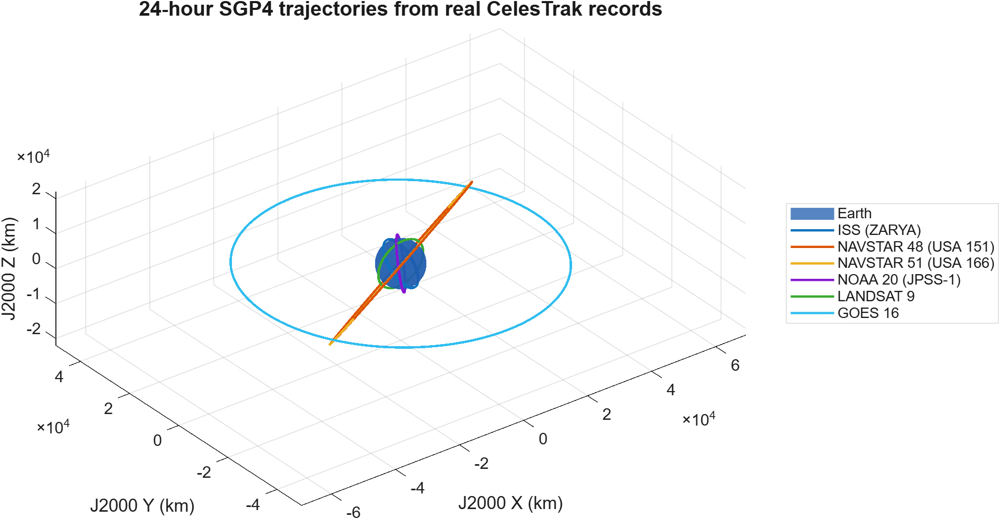
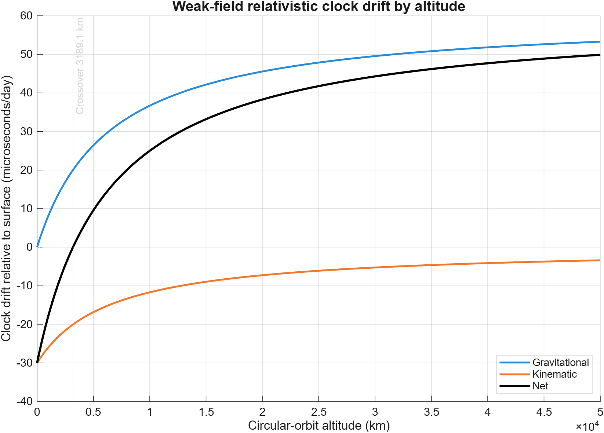

# Near-Real-Time Satellite Tracking, Orbital Dynamics & Relativistic Time Dilation

MATLAB aerospace engineering portfolio project developed over 14 days.

## Current status

The Days 1–14 implementation and final acceptance campaign are complete.

- Tracks **6 real spacecraft** across LEO, MEO, and GEO from validated CelesTrak
  records: ISS, two NAVSTAR/GPS satellites, NOAA-20, Landsat 9, and GOES-16.
- Propagates records with Vallado/CelesTrak SGP4 and compares them with a custom
  `ode45` two-body model over 1, 6, and 24 hours in a documented J2000/FK5 frame.
- Resolves model differences into radial, along-track, and cross-track components.
- Combines special- and weak-field gravitational-relativistic timing. The GPS
  result is **+38.452079 microseconds/day** relative to an idealized stationary
  equatorial surface clock.
- Completed **120/120 automated simulations** and passed **17/17 final
  verification checks** in MATLAB R2026b on 2026-10-21.
- Exports six final PNG/FIG figures, CSV/MAT evidence, a technical report,
  acceptance review, demonstration plan, and quantified resume bullets.
- Provides one Satellite Observer application with a five-second Live Now
  geographic readout, engineering results, exports, verification, report access,
  and the native `satelliteScenario` globe workflow.

The largest 24-hour two-body–SGP4 separation was 1,781.797863 km. This is
**model disagreement, not independently validated tracking error**.

## Requirements

- MATLAB R2026b (base MATLAB for the original numerical workflows)
- Satellite Communications Toolbox for the native `satelliteScenario` workflow
- Communications Toolbox, DSP System Toolbox, and Signal Processing Toolbox
  (installed dependencies of Satellite Communications Toolbox)

Base-MATLAB numerical analysis and the saved engineering-results view do not
require Satellite Communications Toolbox. Live Now and the native globe do.

## Repository layout

| Path | Purpose |
|---|---|
| `src/dynamics` | Equations of motion and force models |
| `src/propagation` | Numerical propagators and propagation interfaces |
| `src/analysis` | Orbital quantities, error metrics, and comparisons |
| `src/visualization` | Reusable plotting functions |
| `src/io` | CelesTrak, TLE, configuration, and file I/O |
| `src/relativity` | Special- and general-relativistic timing models |
| `src/dashboard` | Near-real-time tracking dashboard code |
| `scripts` | Reproducible top-level workflows |
| `tests` | MATLAB verification and regression tests |
| `data/raw` | Unmodified external orbital data |
| `data/processed` | Parsed or transformed data |
| `config` | Constants and scenario configuration |
| `results` | Machine-readable numerical outputs |
| `figures` | Exported plots and graphics |
| `docs/logs` | Daily engineering logs |
| `docs/report` | Technical report source and supporting material |
| `docs/video` | Demonstration-video outline and assets |

## Reproducibility rule

Top-level scripts call reusable functions in `src`; source functions do not depend on interactive workspace variables. Generated results and figures are saved outside `src`.

## Final quick start

### One-click Windows application

Double-click **Satellite Observer** on the Windows desktop. The shortcut launches
the application with the installed MATLAB R2026b runtime, shows a loading window,
and exits MATLAB automatically when the application closes.

The repository also contains `Satellite Observer.cmd`; double-click it directly if
the desktop shortcut is moved or deleted. Recreate the shortcut with:

```powershell
powershell -ExecutionPolicy Bypass -File scripts/install_windows_shortcut.ps1
```

MATLAB Compiler is not required for this launcher, but MATLAB R2026b must remain
installed. The optional native 3-D globe requires Satellite Communications Toolbox.

### MATLAB launch

From the repository root:

```matlab
setupProject;
addpath("scripts");
outputs = run_final_engineering_sprint();
```

The command reuses the saved campaign by default and reproduces final verification,
performance metrics, and figures. Force all 120 simulations to run again with
`run_final_engineering_sprint(ReuseCampaign=false)`.

Launch Satellite Observer:

```matlab
app = launchSatelliteObserver();
```

Satellite Observer selects any tracked satellite and can switch into **LIVE NOW**
for a current SGP4-propagated latitude, longitude, altitude, speed, and orbital-data
age with five-second updates. This is an orbital-elements estimate, not onboard
telemetry. Press **LIVE 3-D VIEW** to open MATLAB `satelliteScenario` at the current
UTC time and automatically play all six moving satellites and their ground tracks.
The same app also provides 1-, 6-, and 24-hour engineering predictions, two-body
separation and RTN components, relativistic timing, exports, acceptance checks, and
the final report.

## Final results

| Metric | Result |
|---|---:|
| Real satellites analyzed | 6 |
| Satellite/horizon comparison cases | 18 |
| Successful automated simulations | 120/120 |
| Final verification checks | 17/17 |
| Maximum position separation | 1,781.797863 km |
| Global RMS position separation | 575.823254 km |
| Maximum relative energy drift | 6.0711e-10 |
| Maximum relative angular-momentum drift | 3.0380e-10 |
| Tightest 6-hour convergence difference | 0.0001157 m |
| GPS net relativistic correction | +38.452079 microseconds/day |
| Relative difference from +38.5 benchmark | 0.1245% |
| Dashboard snapshot update latency | 0.884 ms |





Detailed evidence is in `results/final_*`,
`docs/report/final-engineering-report.md`,
`docs/report/final-audit-and-acceptance.md`,
`docs/video/final-demonstration-plan.md`, and `docs/resume-entry.md`.
The paginated seven-page report is
`output/pdf/satellite_tracking_final_engineering_report.pdf`.

## Day 1 quick start

From the repository root in MATLAB:

```matlab
setupProject;
addpath("scripts");
outputs = run_day01_circular_orbit();
```

The workflow writes two renderer-independent SVG plots to `figures`, CSV summaries
to `results`, and a MAT-file containing the complete simulation state. No optional
toolbox is required. To additionally request PNG exports through MATLAB's graphics
backend, run `run_day01_circular_orbit(GeneratePngFigures=true)`.

The physics derivation and teaching notes are in
`docs/report/day01-foundation-guide.md`; measured accomplishments are recorded in
`docs/logs/day01-engineering-log.md`.

## Day 3 quick start

From the repository root in MATLAB:

```matlab
setupProject;
addpath("scripts");
outputs = run_day03_advanced_orbits();
```

This runs six idealized ECI orbit scenarios for one Kepler period each, writes the
comparison and verification CSV files to `results`, saves complete state histories
to `results/day03_simulations.mat`, and exports the 3D comparison to `figures`.
The workflow uses base MATLAB and does not require Aerospace Toolbox.

Day 3 equations, conventions, scenario rationale, and tolerance explanations are
in `docs/report/day03-advanced-orbits-guide.md`. Measured results and limitations
are in `docs/logs/day03-engineering-log.md`.

## Day 4 Task 1 quick start

```matlab
setupProject;
addpath("scripts");
outputs = run_day04_task1_energy();
```

See `docs/report/day04-numerical-verification-guide.md` for the energy derivation,
readiness assessment, and staged Day 4 roadmap.

## Day 5 status

Read `docs/report/day05-celestrak-integration-guide.md` before implementing the
network layer. It explains why OMM-compatible CSV is preferred, separates element
epoch from retrieval time, and prevents GP mean elements from being misused as
instantaneous classical elements.

Run the completed Task 2 workflow from the repository root:

```matlab
setupProject;
addpath("scripts");
outputs = run_day05_task2_retrieval();
```

By default this uses a valid cache younger than two hours. Pass
`ForceRefresh=true` only when a new provider retrieval is actually required.

Run the completed Task 3 catalog workflow:

```matlab
setupProject;
addpath("scripts");
outputs = run_day05_task3_catalog();
```

Run the real-record SGP4 simulation and open the interactive viewer:

```matlab
setupProject;
addpath("scripts");
outputs = run_day05_real_satellite_simulation();
```

Press **Play** to animate the five spacecraft. Drag the axes to rotate, use the
mouse wheel to zoom, drag the timeline slider to scrub, and select 1x–30x from the
speed menu. Click any moving marker (or choose it under **Observe a satellite**)
to see that satellite's exact UTC sample, TEME position and velocity, altitude,
and speed. The readout updates continuously while playing or scrubbing. The
default run covers 12 hours at 120-second intervals and exports a
MAT-file, three verification/summary CSV files, a PNG, and an editable FIG file.

The viewer is Earth-centered TEME, the native output frame of SGP4. It is an
orbital analysis view rather than a rotating-Earth ground-track map.

### Native `satelliteScenario` viewer

The installed Satellite Communications Toolbox can now drive the same five real
spacecraft in MATLAB's native 3-D globe. The workflow retrieves validated
CelesTrak TLE records, caches them for two hours, and uses MATLAB's native
SGP4/SDP4 propagators (SDP4 is selected automatically for deep-space orbits):

```matlab
setupProject;
addpath("scripts");
outputs = run_day05_satellite_scenario();
```

Drag the globe to orbit the camera, scroll to zoom, and use the viewer's timeline
controls to scrub or play. The companion **Satellite Time & Position** panel
follows the globe timeline and reports the selected spacecraft's UTC time,
latitude, longitude, altitude, inertial position and velocity, and speed. To begin
playback immediately at 300x real time, run
`run_day05_satellite_scenario(AutoPlay=true)`. For automated verification without
opening the globe, pass `ShowViewer=false`.

## Day 7 quick start

```matlab
setupProject;
addpath("scripts");
outputs = run_day07_sgp4_two_body_comparison();
```

This uses cached records by default. Use `ForceRefresh=true` to request new GP
records. The comparison converts TEME states into a documented J2000/FK5 ECI
realization using current CelesTrak EOP data before initializing the two-body
model. See `docs/report/day07-sgp4-two-body-guide.md` for the physics, frame,
time-scale, and interpretation rules.

## Day 8 quick start

```matlab
setupProject;
addpath("scripts");
outputs = run_day08_special_relativity();
```

Day 8 reuses the saved Day 7 J2000/FK5 position and velocity histories. It
integrates the exact cancellation-resistant kinematic clock rate and its
low-velocity approximation for six real satellites and three theoretical
orbits. Gravitational time dilation and ground-clock comparisons are explicitly
deferred to Day 9. See `docs/report/day08-special-relativity-guide.md` for the
derivation, coordinate convention, results, and limitations.

To animate those same nine Day 8 histories in MATLAB's native 3-D viewer, run:

```matlab
outputs = run_day08_satellite_scenario();
```

Playback starts automatically at 900x real time. The six real CelesTrak cases
and three theoretical comparison orbits all move on the 24-hour Day 8 timeline;
the exported catalog links every trajectory to its computed special-relativistic
clock drift. A separate visibility panel provides an individual checkbox for
every trajectory and quick filters for **All**, **Real only**, **Theoretical
only**, and **None**. A live observation panel also lets you select any trajectory
and inspect its time and inertial position while the timeline moves.

## Day 9 quick start

```matlab
setupProject;
addpath("scripts");
outputs = run_day09_general_relativity();
```

Day 9 applies the weak-field gravitational potential correction and the Day 8
velocity correction to nine saved trajectories. It exports summary and
time-series CSV files, a MAT result, verification evidence, and four PNG/FIG
figure pairs. The derivation, reference-clock convention, crossover analysis,
and limitations are documented in
`docs/report/day09-general-relativity-guide.md`; measured results are recorded
in `docs/logs/day09-engineering-log.md`.

