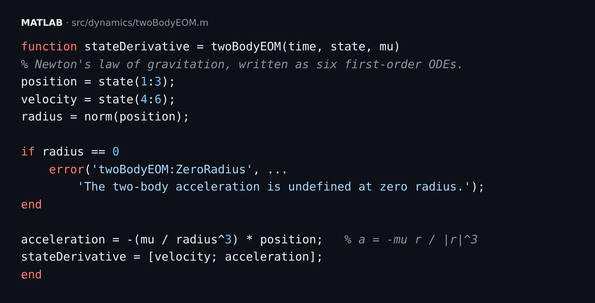
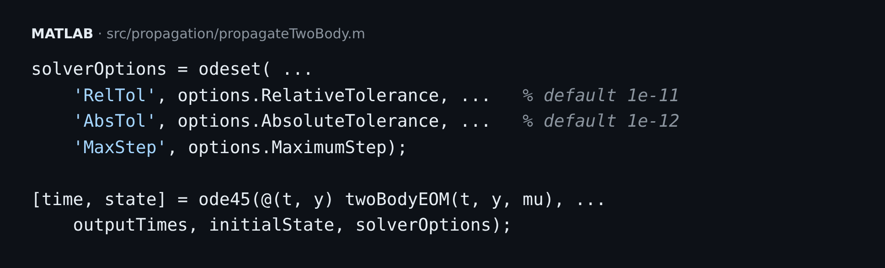
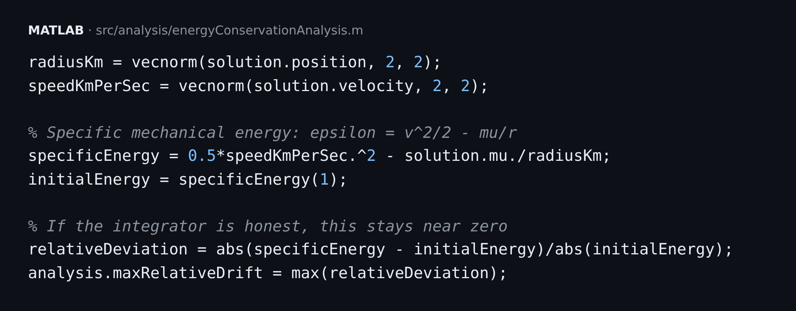
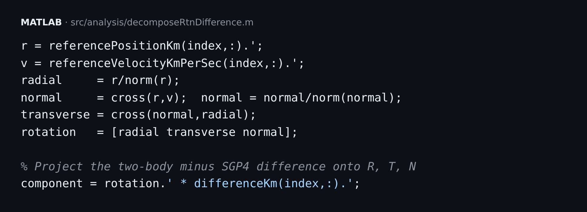
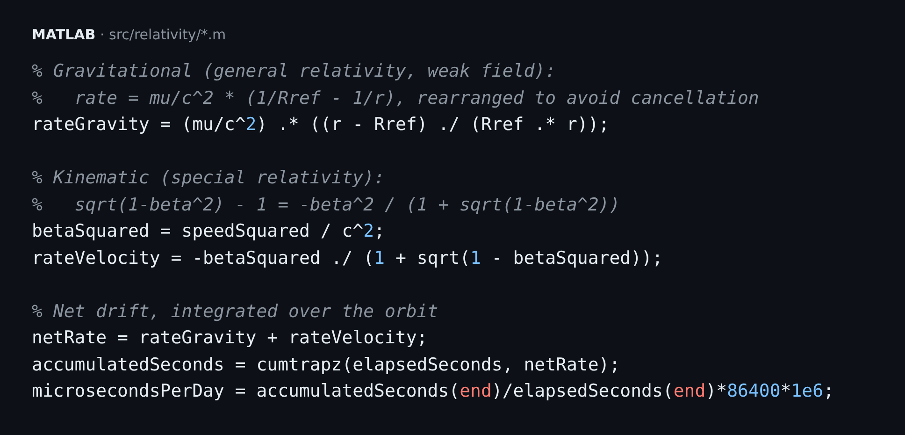

# Two Classes, One Orbit: How ME Tools and Intermediate Physics Turned Into a Satellite Tracker

*I took a MATLAB course and a physics course that each felt self-contained. Then I tried tracking real satellites, and found I needed both.*

---

## Two classes, separate in my head

I was taking two classes this year:

- **ME Tools**, where I learned MATLAB properly: functions, vectors, plotting, ODE solvers, and writing code someone else could rerun.
- **Intermediate Physics**, where I worked through Newtonian gravity, conservation of energy and angular momentum, and special relativity.

I treated them as unrelated. One was about writing code and the other was about working through derivations on paper. Then I came across a fact I couldn't stop thinking about: **GPS satellite clocks run about 38 microseconds a day faster than clocks on the ground.** Without a correction, GPS positions would drift by roughly 10 km a day.

That number comes from physics, but checking it against a real satellite takes code. So I spent 14 days building a project that needed both classes.

The result is a MATLAB application that tracks six real satellites (ISS, two GPS satellites, NOAA-20, Landsat 9 and GOES-16), predicts their orbits two different ways, and calculates how relativity changes their clocks.

---

## Chapter 1: Writing a physics equation as code

In Intermediate Physics, gravity looks like this:

**F = −GMm r̂ / r²**

That is one line on a whiteboard. ME Tools taught me that a computer can't do anything with it as written. MATLAB's ODE solvers need **first-order** equations. So you split the second-order equation into six first-order ones, three for position and three for velocity, and write a function that returns the derivatives:

Here is where the two classes met. The last two lines of that function *are* Newton's law of gravitation, and the rest is the structure ME Tools taught me. Physics supplies the equation. MATLAB needs it in a particular format.

Then `ode45` does the integration:

In ME Tools, `RelTol` and `AbsTol` looked like settings you could ignore. In this project they decide whether the simulated satellite holds its orbit or slowly spirals away.

---

## Chapter 2: Using conservation laws to test the code

How do you know the simulation is right?

Physics class answered that. In a two-body system with no drag, **specific mechanical energy is conserved:**

**ε = v²/2 − μ/r**

So it should stay constant at every time step. If it drifts, the solver is introducing error. A conservation law that I'd only used on homework became a test for my own code:

I ran it across **120 automated simulations**: 5 orbit sizes × 4 eccentricities × 6 inclinations, each run for one full orbit.

- **120/120 passed**
- Worst relative energy drift: **6.07 × 10⁻¹⁰**
- Worst angular-momentum drift: **3.04 × 10⁻¹⁰**
- Tightening the solver tolerance from 1e-6 to 1e-12 shrank the 6-hour position error from **1.57 m to 0.12 mm**

The physics told me what *should* happen. The code let me measure whether it did.

---

## Chapter 3: The day my model was off by 1,781 km

Next I loaded real orbital data from CelesTrak. I propagated each satellite with two models:

1. **SGP4**, the industry-standard model for this kind of data
2. **My two-body `ode45` model** from Chapter 1

After 24 hours they disagreed by up to **1,781.8 km**, on Landsat 9.

My first reaction was that I'd made a mistake. I hadn't. My Intermediate Physics model treats Earth as a perfect point mass. The real Earth bulges at the equator, has an atmosphere that drags on low satellites, and is pulled on by the Moon and Sun. SGP4 accounts for some of those effects and my model accounts for none of them.

To see *where* the difference came from, I broke it into three directions: radial (up/down), along-track (ahead/behind) and cross-track (sideways). That's the RTN frame:

That's cross products and unit vectors from physics, written as matrix operations from ME Tools. It showed that **about 1,765 km of the 1,781 km was along-track.** The satellite wasn't off its path. It was in a different spot along the same path, because a tiny error in orbital speed builds up over every lap.

**The lesson that mattered most:** I don't call that 1,781 km "error." I had no independent ground-truth measurement, so the honest term is **model disagreement.** That distinction is easy to skip when you want an impressive number, and that's exactly when it matters.

One step in between also caught me out: SGP4 outputs positions in a reference frame called TEME, and my model used J2000. Subtracting positions from two different frames gives a meaningless answer. I had to convert every SGP4 state into J2000 before comparing anything.

---

## Chapter 4: Applying special relativity to a real satellite

This was the part I'd been waiting for.

In Intermediate Physics, time dilation came with idealized thought experiments: trains, light clocks, twins. Here it was applied to actual satellites. Two effects compete:

- **Special relativity:** a fast-moving clock runs *slower*, by about −v²/2c².
- **Gravitational time dilation:** a clock higher above Earth's mass runs *faster*, by about (μ/c²)(1/R_E − 1/r).

ME Tools ended up mattering here in a way I didn't expect. The rates are tiny, around 10⁻¹⁰. Computing √(1−β²) − 1 directly subtracts two numbers that are almost equal, and floating-point precision loses most of the significant digits. Rewriting it algebraically as −β²/(1 + √(1−β²)) fixes that. The physics doesn't change; only the numerics do.

**The results:**

| Satellite | Gravity | Velocity | **Net** |
|---|---:|---:|---:|
| GPS (theoretical, 20,200 km) | +45.661 µs/day | −7.209 µs/day | **+38.452 µs/day** |
| ISS (LEO) | small gain | large loss | **≈ −24.5 µs/day** |
| GOES-16 (GEO) | large gain | small loss | **≈ +46.5 µs/day** |

The GPS result came out **within 0.125% of the textbook +38.5 µs/day.**

The ISS result surprised me. Its clock runs *slow*, because at low altitude the speed effect beats the gravity effect. Under my model's assumptions, the two effects cancel exactly at **3,189 km altitude.** I never saw that crossover in class. It only showed up once I put both formulas into one model and swept altitude.

One caveat I had to learn: the "+38.5" figure assumes a particular reference clock, an idealized stationary clock at Earth's equatorial radius. Change the reference and the number changes too.

---

## Chapter 5: Packaging it into an app

ME Tools always pushed reproducibility: code someone else can run and get the same answer. So I finished by building **Satellite Observer**, a MATLAB app that includes:

- **LIVE NOW** mode: the current SGP4-estimated latitude, longitude, altitude and speed for any of the six satellites, updated every five seconds
- An embedded 3-D `satelliteScenario` globe with all six satellites and their ground tracks moving in real time
- 1-, 6- and 24-hour predictions, RTN plots, relativity results and exports
- A **17-check verification suite**, with all 17 passing

---

## What I'd tell myself at the start of both classes

1. **Every equation in physics is a function you can write.** The derivation is the specification and the code is the implementation.
2. **Conservation laws are test cases.** Anything that should be conserved can be used to check your simulation.
3. **Numerics are physics too.** Rearranging an equation can mean the difference between a correct answer and floating-point noise.
4. **Frames and conventions come before results.** If you skip them, the number you get doesn't mean anything.
5. **Report what you don't know.** "Model disagreement, not error" is less impressive than "error," but it's accurate.

I started out thinking ME Tools and Intermediate Physics were separate subjects. This project showed me I needed both to solve one problem.

---

**Tech:** MATLAB R2026b · `ode45` · Vallado/CelesTrak SGP4 · J2000/FK5 frame conversion · Satellite Communications Toolbox · CelesTrak orbital data

**Code, figures, daily engineering logs and the full technical report:** github.com/cloud-byte1/satellite-tracking-matlab

If you work in astrodynamics or GNSS, I'd welcome a critique, especially of the clock reference convention.

#MechanicalEngineering #Physics #MATLAB #OrbitalMechanics #Aerospace #SatelliteTracking #GPS #Relativity #EngineeringStudent #STEM
